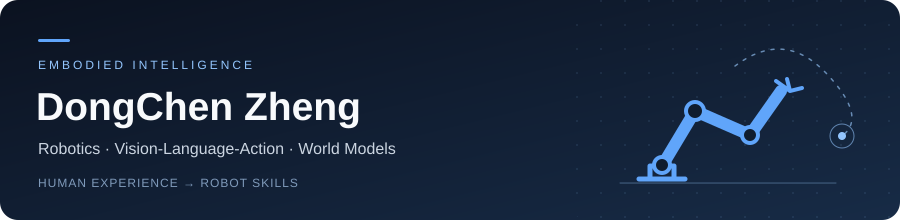
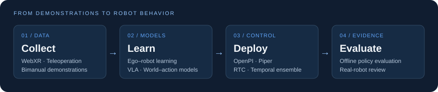

  

  <strong>MSc student in Robotics and Intelligent Systems · The University of Hong Kong</strong> 
  Previously studied Automation at Northeastern University.

  <a href="https://www.linkedin.com/in/stevezheng1120/">LinkedIn</a> &nbsp;·&nbsp;
  <a href="#research-interests">Research</a> &nbsp;·&nbsp;
  <a href="#selected-work">Projects</a> &nbsp;·&nbsp;
  <a href="https://github.com/sssssteve?tab=repositories">Repositories</a>

### About

I'm interested in how robots learn from human experience and turn perception into useful actions. My current focus is on **Vision-Language-Action models**, **world–action modeling**, and **robot learning**, with an interest in reinforcement learning.

My work spans ego–robot learning, bimanual manipulation, demonstration collection, policy deployment, and evaluation.

### Research interests

<table>
  <tr>
    <td width="50%" valign="top">
      <h4>🦾 Vision-Language-Action</h4>
      
Connecting visual observations and language instructions to robot actions, with a focus on bimanual manipulation.

      Policy learning · Action representations · Generalization
    </td>
    <td width="50%" valign="top">
      <h4>🌐 World &amp; Action Models</h4>
      
Exploring how predicting future observations and actions can support robot learning.

      Video prediction · Joint world–action modeling
    </td>
  </tr>
  <tr>
    <td width="50%" valign="top">
      <h4>👁️ Learning from Human Experience</h4>
      
Studying how egocentric human data and robot demonstrations can share useful representations across embodiments.

      Ego–robot learning · Embodiment alignment · Pretraining
    </td>
    <td width="50%" valign="top">
      <h4>🔁 Self-Improving Robot Learning</h4>
      
Interested in learning from failures and using evaluation feedback to guide the next iteration.

      Reinforcement learning · Failure analysis · Policy evaluation
    </td>
  </tr>
</table>

### From data to robot behavior

  

### Selected work

<table>
  <tr>
    <td width="50%" valign="top">
      <h4><a href="https://github.com/Agentic-Intelligence-Lab/Atom-0">Atom-0 ↗</a></h4>
      
Ego–robot integration for embodied foundation model pretraining.

      
Three research routes: dual action heads, progressive embodiment alignment, and joint world–action modeling.

      Embodied AI · VLA · WAM · Team project
    </td>
    <td width="50%" valign="top">
      <h4><a href="https://github.com/sssssteve/robodojo-vr-collector">RoboDojo VR Collector ↗</a></h4>
      
Browser-based WebXR teleoperation and demonstration collection for bimanual RoboDojo simulation.

      
Connects operator input, simulation, camera streams, and HDF5 recording.

      WebXR · Isaac Sim · Teleoperation · Data collection
    </td>
  </tr>
  <tr>
    <td width="50%" valign="top">
      <h4><a href="https://github.com/Agentic-Intelligence-Lab/openpi-jax-rtc-te">Piper OpenPI · RTC &amp; TE ↗</a></h4>
      
JAX policy serving and bimanual Piper execution with two independent action-chunking approaches.

      
Real-time chunking for plan continuity; temporal ensembling for overlapping action predictions.

      OpenPI · JAX · Bimanual control · Team repository
    </td>
    <td width="50%" valign="top">
      <h4><a href="https://github.com/sssssteve/universal_offline_eval">Unified Offline Evaluation ↗</a></h4>
      
Offline evaluation for Atom0 Unified80 policies, covering π₀.₅ and FastWAM backends.

      
Explicit model and data contracts, action metrics, flow loss, and traceable evaluation outputs.

      Evaluation · Action prediction · Reproducibility
    </td>
  </tr>
</table>

#### Piper Eval Atlas

**[Explore the repository →](https://github.com/sssssteve/Piper-Eval-Atlas)**

A dashboard for reviewing Piper real-world and offline checkpoint evaluations, complementing the policy and evaluation tools above.

  
<strong>How these projects fit together</strong>

- **Collect:** RoboDojo VR Collector provides a teleoperation and demonstration-recording workflow.
- **Learn:** Atom-0 explores human–robot data integration and embodied model pretraining.
- **Deploy:** Piper OpenPI connects JAX policies to bimanual robot execution.
- **Evaluate:** Unified Offline Evaluation produces offline metrics; Piper Eval Atlas presents evaluation records.

These projects cover different parts of the research workflow; they have their own setup requirements and validation scope.

### Tools I work with

  

Python · PyTorch · JAX · OpenPI · Isaac Sim / Isaac Lab · Piper

| Area | Tools &amp; platforms |
| :--- | :--- |
| Learning | PyTorch, JAX, OpenPI, VLA and world–action models |
| Simulation &amp; collection | Isaac Sim, Isaac Lab, RoboDojo, WebXR, HDF5 |
| Deployment &amp; evaluation | Bimanual Piper, RTC, temporal ensembling, offline evaluation |
| Development | Python, Git, Linux |

### GitHub activity

  <a href="https://github.com/sssssteve?tab=repositories">
    <picture>
      <source media="(prefers-color-scheme: dark)" srcset="https://github-stats-extended.vercel.app/api?username=sssssteve&amp;show_icons=true&amp;hide_rank=true&amp;hide_border=true&amp;theme=github_dark&amp;bg_color=00000000&amp;custom_title=Public%20GitHub%20Activity" />
      
    </picture>
  </a>

### Let's connect

I'm happy to connect with people working on **robot learning, VLA, world models, and bimanual manipulation**.

**[Find me on LinkedIn →](https://www.linkedin.com/in/stevezheng1120/)**
